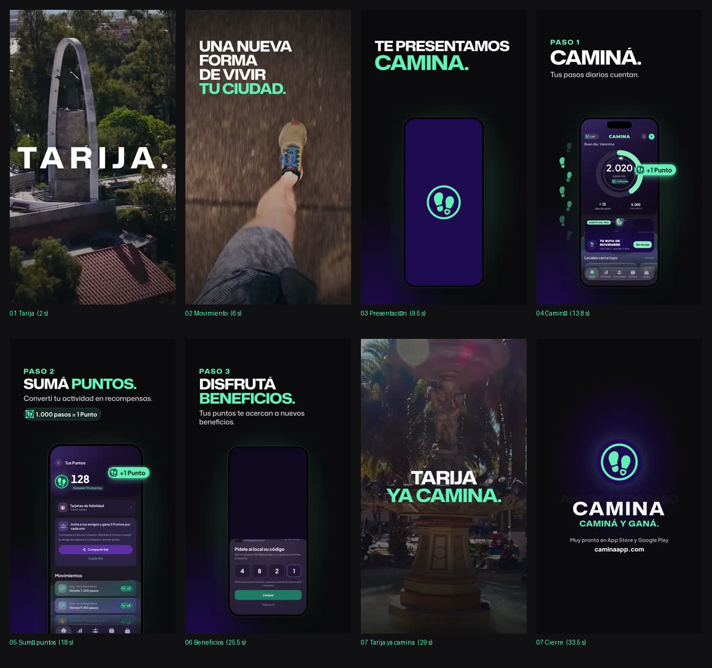

# CAMINA · Video oficial de lanzamiento

**Concepto:** TARIJA YA CAMINA. → AHORA, CADA PASO CUENTA. → CAMINA · CAMINÁ Y GANÁ.
**Formatos:** vertical 1080 × 1920 (Reels, TikTok, Facebook) y horizontal 1920 × 1080 (YouTube, pantallas). 35 s, 30 fps.
**Cómo está hecho:** con código ([Remotion](https://www.remotion.dev), React). Cada escena es un componente en `src/Lanzamiento.tsx`; cambiar un texto o un tiempo y volver a exportar lleva minutos.



## 1. Guion definitivo (tal como está armado)

| Seg. | Escena | Imagen | Texto en pantalla | Sonido |
|---|---|---|---|---|
| 0–3,5 | 01 Tarija | Toma aérea real de la Loma de San Juan y la ciudad (con permiso del autor). Abre desde negro, acercamiento lento, color cálido. | **TARIJA** (las letras se juntan) | Colchón de acordes y ambiente de ciudad, muy suave. |
| 3,5–7 | 02 El movimiento | Pies de gente caminando (Pexels) → caminata en primera persona (Pexels) → Plaza Luis de Fuentes (con permiso). Cortes cada 1,3 s. | **UNA NUEVA FORMA / DE VIVIR / TU CIUDAD.** | Pasos al ritmo, pulso de bombo suave. Destello en el corte. |
| 7–10 | 03 Te presentamos Camina | Fondo negro con brillo morado y verde. Sube un iPhone con el logo (como al abrir la app) y pasa a la pantalla Inicio real (la tarjeta de la Ruta muestra el mapa de Tarija). | **TE PRESENTAMOS / CAMINA.** | Barrido de transición. |
| 10–14,5 | 04 Caminá | Inicio real en vivo: los pasos suben de 1.912 a 2.040; al cruzar 2.000 se suma 1 Punto (pastilla y saldo). Huellas de Camina caminan al costado. Pasa a la pantalla Actividad real. | **PASO 1 · CAMINÁ.** / Tus pasos diarios cuentan. | Entra el ritmo completo. Sonido de moneda en el +1 Punto. |
| 14,5–18,5 | 05 Sumá puntos | Pantalla «Tus Puntos» real; la cámara se acerca al saldo. Salen tres «+1 Punto». | **PASO 2 · SUMÁ PUNTOS.** / Convertí tu actividad en recompensas. / **1.000 pasos = 1 Punto** (regla real). | Arpegio brillante; tres monedas. |
| 18,5–24 | 06 Disfrutá beneficios | Mapa real de Canjes con los comercios → lista real de Canjes (baja) → sube la hoja «Pídele al local su código» → «¡Canje confirmado!». | **PASO 3 · DISFRUTÁ BENEFICIOS.** / Tus puntos te acercan a nuevos beneficios. | Toques suaves al escribir el código; campanita al confirmar. |
| 24–27 | 06b Y mucho más | Ruta del mes (mapa con el recorrido y los 3 locales) → Ranking semanal → Perfil con insignias. Datos de ejemplo (Valentina R., nombres inventados), sin fotos de personas. | **Y MUCHO MÁS.** · Ruta del mes · Ranking semanal · Tu perfil e insignias | Subida hacia el cierre. |
| 27–30 | 07 Tarija ya camina | La fuente de la Plaza Luis de Fuentes. | **TARIJA / YA CAMINA.** | Golpe grave + acorde abierto. |
| 30–35 | 07 Cierre | Negro con brillo morado. El logo original entra con rebote y un aro verde que se abre. Después la tarjeta final. | **AHORA, CADA PASO / CUENTA.** → **CAMINA** · **CAMINÁ Y GANÁ.** · Muy pronto en App Store y Google Play · caminaapp.com | Segundo golpe (el más fuerte) y el acorde se apaga. |

**Reglas que respeta:** todas las pantallas son capturas reales de la app con datos de ejemplo (Valentina, 247 Puntos); ningún premio inventado (se sacaron las pantallas con el Panchito); la app todavía no está en las tiendas, así que dice «Muy pronto», sin distintivos de descarga.

## 2. Recursos usados y su origen

| Recurso | Archivo | Origen / licencia |
|---|---|---|
| Aérea, parque, plaza, fuente de Tarija | `public/tarija/aerea|parque|plaza|fuente.mp4` | Video «Tarija Bolivia 4K» de YouTube, **con permiso del autor** (confirmado por Camina). |
| Pies caminando | `public/tarija/pies-gente.mp4`, `pies-pov.mp4` | Pexels (licencia libre, uso comercial). |
| Pantallas de la app | `public/app/*` | Capturas reales de la app oficial. Ruta, Ranking y Perfil se limpian con `scripts/pantallas.py` (nombres, fotos y números de ejemplo). |
| Logo, huellas, moneda | `public/marca/*`, `public/app/camina-coin.png` | Archivos oficiales de Camina. |
| Música y efectos | `public/audio/musica.wav`, `sfx.wav` | **Originales, generados por código** (`scripts/musica.py`). Sin derechos de terceros. Es una pista provisional: para el lanzamiento conviene una pista con licencia (ver punto 6). |
| Tipografías | `public/fonts/*` | Mona Sans (OFL) y Plus Jakarta Sans (OFL), las de la web y la app. |

Los videos y el audio no se suben a GitHub (pesan mucho). Para regenerarlos: los cortes de Tarija salen de los archivos originales con los comandos de `scripts/cortes.sh`; el audio, con `python3 scripts/musica.py`.

## 3. Exportar

```bash
npm i
npx remotion render LanzamientoVertical out/Camina-lanzamiento-vertical.mp4 --crf=18
npx remotion render LanzamientoHorizontal out/Camina-lanzamiento-horizontal.mp4 --crf=18
npx remotion still LanzamientoVertical out/Camina-portada-reel.png --frame=1030
```
Para ver y retocar en el navegador: `npx remotion studio`.

## 4. Qué mejoraría el video (necesita material o herramientas de afuera)

1. **Grabaciones de pantalla nuevas y limpias** (prioridad): hoy las pantallas son capturas fijas con movimiento agregado. Con grabaciones reales la demo se ve aún más viva. Cómo grabarlas:
   - iPhone: Ajustes → Centro de control → agregar «Grabación de pantalla». Modo oscuro activado, brillo al máximo, sin notificaciones (modo No molestar).
   - Usar una **cuenta de prueba con datos de ejemplo** (nunca la de una persona real).
   - Grabar cada recorrido por separado, despacio, 6–8 s cada uno: (A) abrir la app → Inicio; (B) Inicio → Actividad (tocar 7 días / 30 días); (C) Inicio → saldo de Puntos → Tus Puntos; (D) Canjes → mapa → tocar un comercio → su premio; (E) Canjear → escribir el código del local → «¡Canje confirmado!».
   - Mandar los archivos tal cual (.mov). La barra de estado (hora, batería) se tapa en edición, dejando la isla dinámica.
2. **Tomas propias de Tarija**: atardecer en la Plaza, calle La Madrid, San Jacinto, Miraflores, de noche. Celular en horizontal, 4K o 1080p, 5–10 s, cámara quieta o caminando lento.
3. **Música con licencia** para la versión final (punto 6).

### Prompts para Kling AI (tomas de apoyo de 3–5 s)

Usar solo como **apoyo** (texturas, detalles), nunca para «inventar» Tarija: los lugares reconocibles tienen que ser tomas reales. Mismas reglas en todos: *cinematic, 24 fps feel, warm natural color grade, shallow depth of field, no text, no logos, no faces in close-up, realistic.*

1. **Cordones** (escena 02): «Close-up of hands tying the laces of white running sneakers on a stone sidewalk, morning golden light, slow push-in, shallow depth of field, 4 seconds, vertical 9:16. Avoid: brand logos, faces.»
2. **Pisada en cámara lenta** (escena 02): «Low-angle shot at ground level, a sneaker steps onto a colonial cobblestone street, slow motion, dust particles in warm sunlight, camera static, 3 seconds. Avoid: crowds, text.»
3. **Sombras caminando** (escena 02): «Top-down shot of two long shadows of people walking on a sunlit sidewalk at sunset, steady drone-like movement following them, 4 seconds. Avoid: faces, cars.»
4. **Celular en la mano** (escena 03, sin pantalla visible): «A hand takes a black smartphone out of a jeans pocket while walking on a tree-lined street, screen facing away from camera, warm afternoon light, tracking shot, 3 seconds. Avoid: visible screen content, logos.» (La pantalla real se pone después en edición.)
5. **Atardecer de valle** (escena 07, si no hay toma real): «Wide aerial shot slowly moving forward over a green valley with low mountains at golden hour, warm haze, 5 seconds. Avoid: buildings that look European, skyscrapers, text.»

## 5. Guía de edición en CapCut (si se quiere retocar a mano)

Partir del video exportado (`Camina-lanzamiento-vertical.mp4`) y trabajar encima; ya trae cortes, textos y animaciones.
- **0:00–0:04** Si hay una toma propia de Tarija mejor que la aérea, ponerla en una pista superior con la misma duración. Mantener «TARIJA.» encima (copiar desde el video).
- **0:04–0:08** Reemplazar una de las tres tomas por «Cordones» o «Pisada» de Kling si quedan bien. Cortes en cada golpe de la música (0:04, 0:05.3, 0:06.6).
- **0:08–0:27** No tocar las pantallas: son la parte que explica la app. Si se agregan grabaciones nuevas, recortarlas al tamaño exacto de la pantalla del teléfono (usar «Máscara → Rectángulo» con esquinas redondeadas) y respetar los tiempos de cada paso.
- **0:27–0:35** Dejar el cierre tal cual (logo original, sin efectos de CapCut).
- **Música:** silenciar la pista original y poner la pista con licencia; hacer coincidir su golpe fuerte con **0:30** (aparición del logo) y su subida con **0:24–0:27**. Mantener los efectos (pasos, monedas, confirmación) en una pista aparte al 70 %.
- **Exportar:** 1080p, 30 fps, «Tasa de bits: Recomendada» o más alta.

## 6. Música con licencia (recomendado para el lanzamiento)

La pista incluida es original y libre de derechos, pero sencilla. Para la versión final: buscar en la biblioteca de música de CapCut (sección comercial), Epidemic Sound, Artlist o Pixabay Music una pista **electrónica cinematográfica inspiradora de 112–124 BPM** con subida y golpe. Guardar el comprobante de licencia.

## 7. Texto para publicar

**Instagram / Facebook**
> Tarija ya camina. Ahora, cada paso cuenta. 👟
> Camina cuenta tus pasos y los convierte en Puntos para canjear por beneficios en comercios de tu ciudad.
> Muy pronto en App Store y Google Play. Avisame en caminaapp.com
> #Tarija #TarijaBolivia #CaminaApp #Caminar

**TikTok**
> ¿Caminar y ganar en Tarija? Ahora sí 👟 #Tarija #CaminaApp #Bolivia

## 8. Control de calidad

- [x] Tarija reconocible (Plaza Luis de Fuentes, Loma de San Juan) con tomas reales y con permiso.
- [x] Pantallas reales de la app, datos de ejemplo, sin datos personales.
- [x] Se entiende el funcionamiento en 3 pasos (Caminá → Sumá puntos → Disfrutá beneficios).
- [x] Colores oficiales (negro, morado #200A52, verde #62F0B6, blanco). Logo original sin deformar.
- [x] Sin promociones ni premios inventados; sin distintivos de tiendas (todavía no está publicada).
- [x] Textos dentro de la zona segura (márgenes de 90 px a los lados; nada importante abajo del todo, donde van los botones de Reels/TikTok).
- [x] Sin marcas de agua.
- [ ] Música con licencia comercial para la versión final (hoy: pista original provisional).
- [ ] Grabaciones de pantalla nuevas (opcional, mejora la demo).
